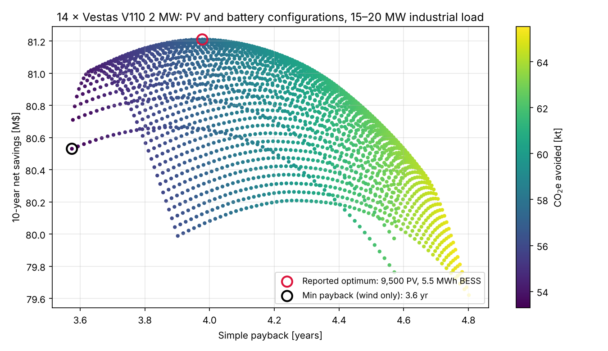
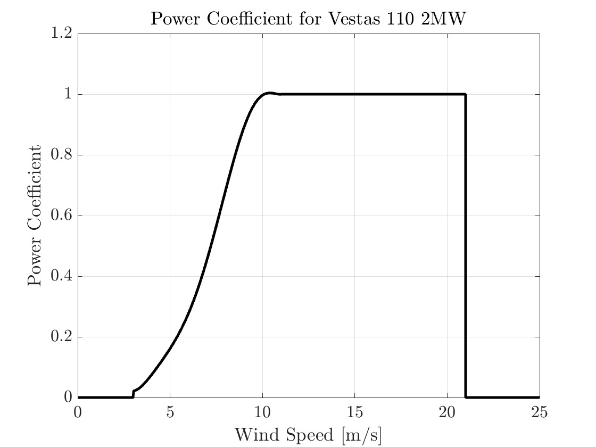
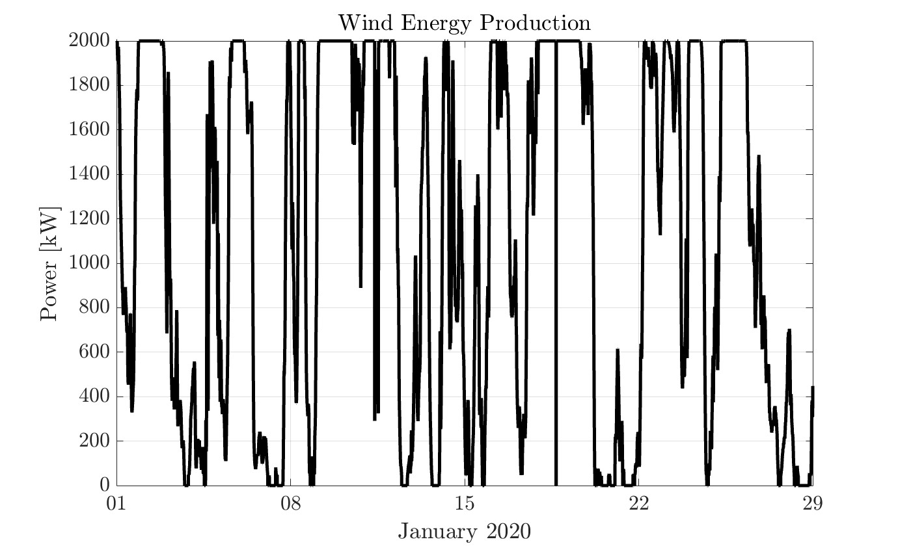
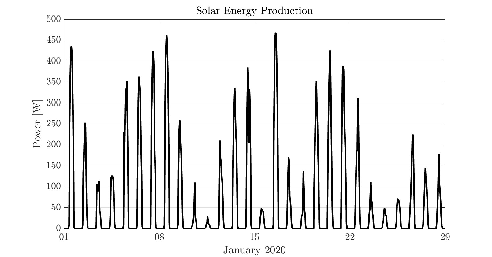

# Wind, Solar and Battery Sizing for an Industrial Load

**How many turbines, panels and kWh of storage should a 15–20 MW factory actually buy?**
A sizing model that works with real makes and models (Vestas V110 2 MW, Jinko Eagle 540 W)
and real weather, simulates a full year at 5-minute resolution for each configuration, and
hands the operator a set of trade-offs instead of a single answer.

*ME 597 (Distributed Energy Resources), Purdue University, Spring 2024.
Two-person project with Sanat Rajagopalan. MATLAB.*

Each point is one PV and battery configuration at 14 turbines, simulated over 2020.
Figure regenerated from this model for the README.

## Results

Case study: a 24/7 automotive assembly plant in West Lafayette, IN, using about
**180 GWh/yr** (15 MW night shift, 20 MW day shifts), with an electricity price of $0.13/kWh.

| | Max-savings configuration |
|---|---|
| Wind | **14 × Vestas V110** (28 MW) |
| Solar | **9,500 × Jinko Eagle 540 W** (5.1 MWp) |
| Battery | **5.5 MWh**, 10 MW power |
| Share of annual load met on site | 58% |
| Equipment cost | $41.3M ($53.6M including 10 years of O&M) |
| 10-year total cost (equipment, O&M, remaining grid purchases) | **$152.8M**, against $234.0M grid-only |
| 10-year net savings | **$81.2M** |
| Simple payback | **3.98 years** |
| Grid emissions displaced | ~66 kt CO₂e per year |

The fastest-payback option is wind alone (3.6 years, $80.5M saved). Adding PV and storage
buys more emissions reduction for a slightly longer payback. The figure above shows that
trade directly, which is the point of returning a set rather than one optimum.

## How it works

| Model | File | What it does |
|---|---|---|
| Load | [`importLoadProfile.m`](src/importLoadProfile.m) | Simulated 5-minute plant demand for 2020 with shift structure and random over- and under-loads |
| Solar | [`simulateSolar.m`](src/simulateSolar.m), [`surfaceIrradiance.m`](src/surfaceIrradiance.m) | Sun position, beam and diffuse irradiance on a fixed surface tilted at latitude, temperature-dependent cell efficiency |
| Wind | [`simulateWind.m`](src/simulateWind.m) | 100 m hub-height wind through a power-coefficient curve fitted to the V110 (cut-in 3, rated 11.5, cut-out 21 m/s) |
| Battery | [`simulateBESS.m`](src/simulateBESS.m), [`simulatePolicy1.m`](src/simulatePolicy1.m) | Discrete-time storage with 95% charge and discharge efficiency, self-dissipation (τ = 1,600 h), power and energy limits; surplus charges, deficit discharges, the rest comes from the grid |
| Sizing | [`run_sizing.m`](run_sizing.m) | Sweeps PV count and battery capacity at a fixed turbine count and scores each configuration on cost, savings, payback and emissions |

The turbine count was chosen in an outer study: a first pass without storage, then repeated
sweeps from 5 to 25 turbines. Total savings peak at 14.

| V110 power coefficient | One turbine, January 2020 | One module, January 2020 |
|---|---|---|
|  |  |  |

## Running it

Requirements: MATLAB R2020b or later. No toolboxes.

1. Add the solar weather file to `data/` (see [`data/README.md`](data/README.md)).
   The wind file is included.
2. Run `run_sizing.m` from the repository root.

Turbine count, prices and sweep ranges are set at the top of `run_sizing.m`. The default
sweep is 4,100 one-year simulations and takes a few minutes. Results vary slightly from run
to run without the fixed seed, because the load profile includes random variation.

## Limitations

- The load profile is synthetic, built from published ranges for a large automotive plant
  rather than metered data.
- The battery follows a simple greedy rule (charge on surplus, discharge on deficit), not
  optimized dispatch, and exporting surplus to the grid is not credited.
- Costs are fixed values from the NREL Annual Technology Baseline and NREL PV and storage cost benchmarks. There are no incentives, financing,
  degradation or price escalation.
- The emissions figure in the original report (57.5 kt CO₂e) nets one year of displaced grid
  emissions against ten years of wind and PV lifecycle emissions. The per-year figure above
  avoids mixing those time bases.

## Data sources

- Wind: NREL Wind Resource Database, 5-minute, 100 m, West Lafayette, 2020
- Solar and temperature: OikoLab (ERA5), hourly, 2020
- Turbine and module specifications: Vestas 2 MW platform, Jinko Eagle 72 G5b datasheets
- Costs: NREL Annual Technology Baseline (land-based wind, commercial PV and battery storage)
- Load ranges: published peak load and annual consumption of the Volkswagen Wolfsburg plant

## Authors

**Jose Ernesto Sandoval Hernandez** and **Sanat Rajagopalan**, Purdue University.
Course taught by Prof. Kevin J. Kircher.

[LinkedIn](https://www.linkedin.com/in/jsahe) · [Google Scholar](https://scholar.google.com/citations?user=cL2oeXIAAAAJ&hl=en)
